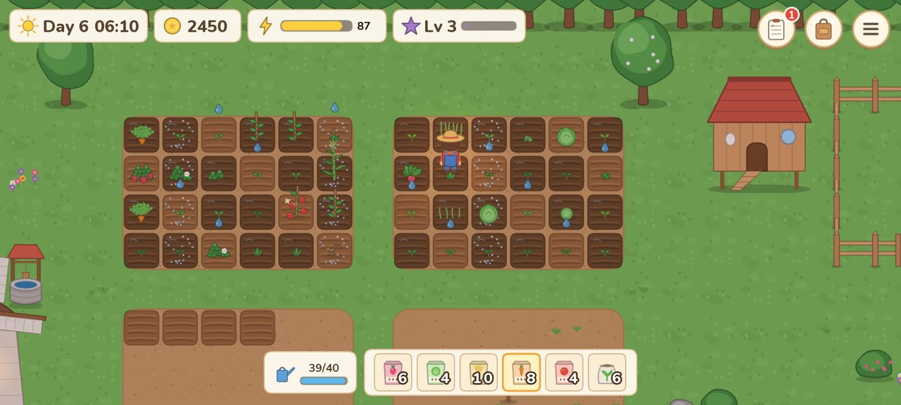
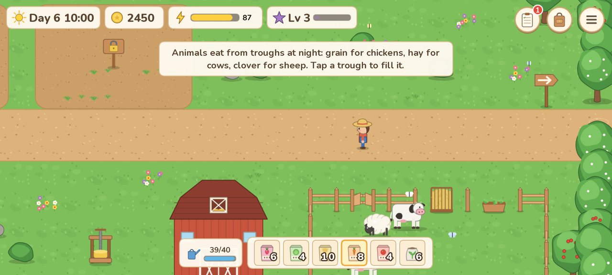
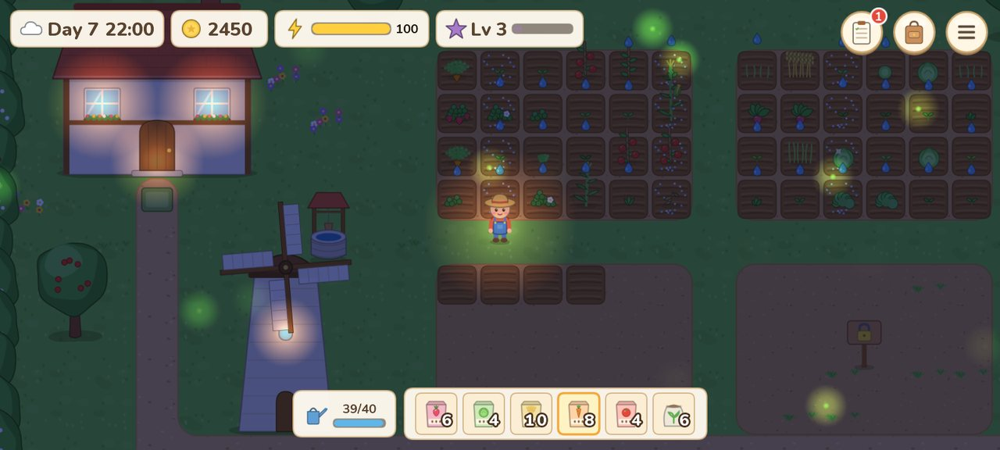
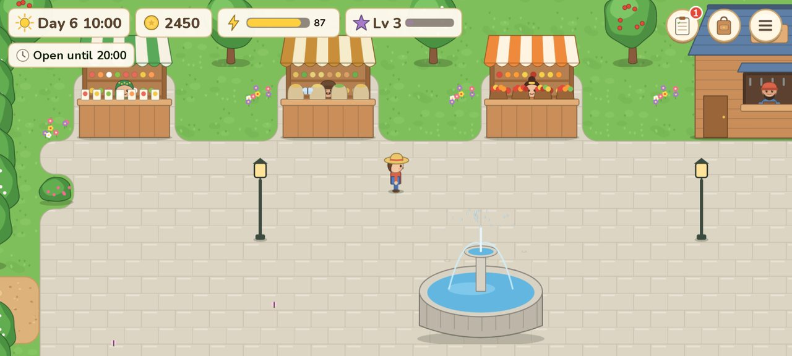
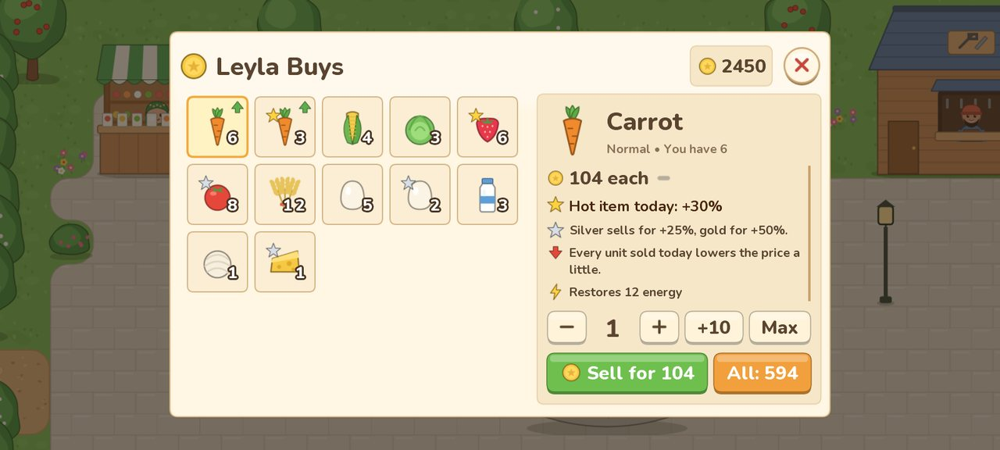
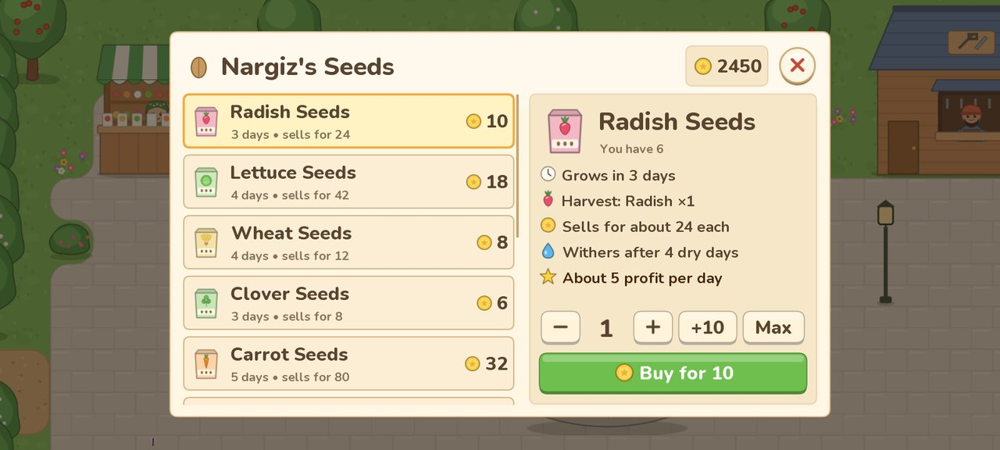
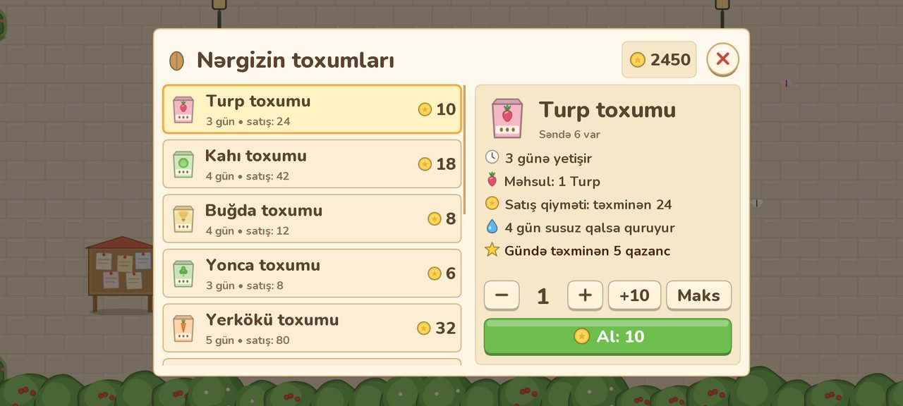

<p align="center">
  
</p>

<h1 align="center">Dewfield</h1>

<p align="center">
  A cozy farm life game for Android, played in landscape: walk with a tap, grow crops, raise animals,<br>
  trade at the market and sleep to start a new day.
</p>

<p align="center">
  <a href="../../actions/workflows/ci.yml"></a>
  
  
  
</p>



| | |
| --- | --- |
|  |  |
|  |  |
|  |  |

## Features

- **Tap to move.**
  - Tap the ground to walk there. Tap a plot to till, plant, water or harvest it.
  - Drag across plots to queue a whole row, and the farmer works through it.
  - Long-press anything to learn what it is. Pinch to zoom.
- **Ten crops, cheap to expensive.**
  - Radishes are ready in 3 days. Pumpkins take 11 days and sell for 450.
  - Expensive crops wither sooner, so they reward daily care.
  - Fertilize and water every day for gold quality (+50%).
- **Animals with their own feed.**
  - Chickens eat grain from the hopper, cows eat hay from the rack, and sheep eat clover from the tray.
  - Fill the troughs, pet your animals, and their mood decides the quality of eggs, milk and wool.
- **A living market.**
  - Nargiz sells seeds, Orkhan sells feed and animals, Leyla buys your goods, and Tural upgrades your farm.
  - Prices drift every day, selling a lot of one thing lowers its price, and one hot item a day pays +30%.
- **Machines and cooking.**
  - The mill turns wheat into hay and corn into grain.
  - The cheese press and the loom turn milk and wool into far more valuable goods.
  - Cook meals on the stove for big energy boosts.
- **Days and nights.**
  - Energy runs out, the sun sets, lamps and fireflies come on, and at midnight you pass out.
  - Rain waters your crops for you, and the TV forecasts tomorrow's weather and hot item.
- **Progress.**
  - Orders from the townsfolk, farm levels that unlock new crops, animals and machines, and upgrades for the can, farmland, coop and barn.
- **Two languages.** English and Azerbaijani, switchable at any time.
- **Offline, no ads, no tracking.** The game requests no Android permissions.

## Download

- Grab the APK from the [latest release](../../releases/latest).
- Or open the latest green [CI run](../../actions/workflows/ci.yml) and download the `dewfield-apk` artifact.
- Open the APK on your phone and allow installs from your browser or file manager.

It needs Android 7.0 or newer.

## Build from source

You need JDK 17+ (21 recommended).

```bash
./gradlew :core:test          # 66 unit tests: rules, world, strings
./gradlew :desktop:run        # play on desktop (mouse = finger, scroll = zoom, Esc = back)
./gradlew :android:assembleRelease   # APK, needs the Android SDK (platform 36)
```

See [CONTRIBUTING.md](CONTRIBUTING.md) for the workflow and [AGENTS.md](AGENTS.md) for the code guide.

## How it's built

| Part | Choice |
| --- | --- |
| Language | Kotlin 2.4 (JVM 17) |
| Engine | libGDX 1.14: SpriteBatch, scene2d UI, FreeType fonts |
| Saves | kotlinx.serialization JSON, written atomically with a backup |
| Art | Vector sprites written as SVG in code, rendered with headless Chromium and packed into one atlas |
| Audio | Effects and music synthesized with numpy and encoded to Ogg Vorbis |
| CI | GitHub Actions: unit tests, release APK and a smoke test on an Android emulator |

### Why libGDX

- **Native Android.** It runs as a plain Android app with a small APK and starts fast on low-end phones.
- **Testable rules.** The game rules are plain Kotlin with no engine types, so 60+ JUnit tests cover planting, growth, prices, animals, machines, orders and saves.
- **A desktop build for free.** The same code runs on desktop for quick iteration and for the automated screenshot tour.
- **Room for iOS later.** A MobiVM launcher can be added without touching the game code.

Godot, Unity and Compose were also considered. See [ADR 0001](docs/adr/0001-native-kotlin-libgdx.md).

## Project layout

```
core/      the game: rules (model), maps and tap-to-move (world), rendering, UI, screens
android/   Android launcher, manifest, icons
desktop/   desktop launcher and the screenshot tour
tools/     art pipeline, i18n generator, audio synthesizer, atlas packer
assets/    atlas, fonts, strings, sounds, music
docs/      architecture, game design, conventions, testing, deployment, ADRs
```

Start with [docs/architecture.md](docs/architecture.md) and [docs/game-design.md](docs/game-design.md).

## Credits

- Design, code, art and audio: Mursal Hakhverdiyev, built with Claude Code. All art and sound is generated from the code in `tools/`.
- Font: [Nunito](https://github.com/googlefonts/nunito) by The Nunito Project Authors, under the SIL Open Font License 1.1 ([assets/fonts/OFL.txt](assets/fonts/OFL.txt)).
- Engine: [libGDX](https://libgdx.com) (Apache 2.0).

## License

No license has been chosen yet, so all rights are reserved by the author. You are welcome to read the code and build it for yourself.
